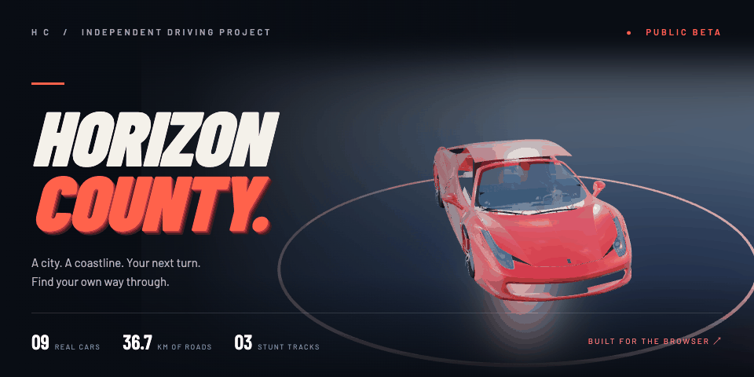

<p align="center">
  <a href="https://horizon-drive-coast.uttkarshchambiyal.chatgpt.site">
    <picture>
      <source media="(prefers-reduced-motion: reduce)" srcset="docs/media/horizon-poster.png">
      
    </picture>
  </a>
</p>

<h1 align="center">Horizon County</h1>
<p align="center"><strong>A city. A coastline. Your next turn.</strong><br>An original 3D driving world, built for the browser.</p>

<p align="center">
  <a href="https://horizon-drive-coast.uttkarshchambiyal.chatgpt.site"><strong>PLAY THE BETA ↗</strong></a>
  &nbsp; · &nbsp;
  <a href="#start-your-engine">RUN LOCALLY</a>
  &nbsp; · &nbsp;
  <a href="docs/TECHNICAL.md">TECHNICAL NOTES</a>
  &nbsp; · &nbsp;
  <a href="dist/assets/cars/ATTRIBUTION.md">ASSET CREDITS</a>
</p>

<p align="center">
  
  
  
  
</p>

---

## Take the long way home

Leave downtown, follow the Pacific coast, climb Crestline Hills, or head for the harbor and airfield. The county connects **36.7 km of roads** in one original map, with a nine-car garage, delivery jobs, checkpoint races, and a separate stunt-track mode.

You control the throttle and steering. Coast into a corner, hold the handbrake, hit nitro on the straight, and earn upgrades along the way. Progress saves in your browser, with no account or backend required.

| Explore | Drive | Chase the next run |
| :--- | :--- | :--- |
| Downtown streets, beach roads, mountain passes, harbor, and airfield | Nine locally bundled car models with distinct arcade handling | Three deliveries and three checkpoint races |
| Map waypoints, six discoverable destinations, and district travel | Visible steering, rolling tires, suspension motion, and collision response | Per-car engine, brake, tire, and nitro upgrades |
| Golden hour, daylight, blue hour, and optional light traffic | Four cameras, headlights, recorded engine audio, horn, and nitro | Daily featured event, personal bests, and medals |

### Beyond the county

Open **Stunt Tracks** from the menu, or visit `/stunts.html` on a running server.

| Track | Jumps | Character |
| :--- | :---: | :--- |
| **Skyline Circuit** | 3 | Find your line above the city |
| **Canyon Launch** | 4 | Commit to the gaps |
| **Neon Heights** | 5 | Keep the next landing in sight |

## Start your engine

Requires **Node.js 20.11+**. The game needs no dependency installation or build step.

```sh
git clone https://github.com/Uttkarshchambiyal/horizon-county.git
cd horizon-county
npm start
```

Open **[127.0.0.1:4173](http://127.0.0.1:4173)**, choose a district, and select **Start Driving**. All starting districts share the same map.

## Driver's briefing

| Key | Action |
| :--- | :--- |
| <kbd>W</kbd> / <kbd>↑</kbd> | Accelerate |
| <kbd>A</kbd> <kbd>D</kbd> / <kbd>←</kbd> <kbd>→</kbd> | Steer; combine with throttle to drive through a turn |
| <kbd>S</kbd> / <kbd>↓</kbd> | Brake, then hold to reverse |
| <kbd>Space</kbd> · <kbd>Shift</kbd> | Handbrake · rechargeable nitro |
| <kbd>M</kbd> | Map, waypoint, and district travel |
| <kbd>J</kbd> · <kbd>G</kbd> | Jobs and races · garage and upgrades |
| <kbd>C</kbd> · <kbd>R</kbd> | Change camera · recover to a safe road position |
| <kbd>L</kbd> · <kbd>V</kbd> · <kbd>H</kbd> | Headlights · sound · horn |
| <kbd>O</kbd> · <kbd>Esc</kbd> / <kbd>P</kbd> | Settings · pause |

Touch steering and pedals are included for narrow screens. Physical-phone testing remains pending.

## Under the hood

**Vanilla JavaScript + Three.js + WebGL.** The runtime ships as static files, including models, textures, fonts, audio, and the renderer. No runtime CDN or game server is required.

- **120 Hz simulation** with interpolated rendering and manual axle-based steering.
- **Adaptive graphics** with Smooth, Performance, and Clarity presets, pixel budgets, instancing, and distance-based detail.
- **Local persistence** for earned credits, upgrades, discoveries, settings, and personal bests.
- **Performance capture** with a downloadable 60-second drive report. Frame-rate targets depend on the device; they are not a guaranteed 60 FPS.

```text
horizon-county/
├── dist/                 # Editable game source and deployable static site
│   ├── index.html        # Open-world entrypoint
│   ├── stunts.html       # Stunt-track entrypoint
│   ├── driving.js        # Open-world driving simulation
│   ├── game.js           # World runtime and UI orchestration
│   ├── assets/           # Models, materials, HDR environment, and audio
│   └── vendor/           # Local Three.js modules and licensed fonts
├── scripts/              # Local server, regression checks, asset tools
└── docs/                 # Technical notes, launch scope, editable README art
```

Despite its name, **`dist/` contains the editable runtime source**. Serve its contents directly from a static host; there is no bundler output to regenerate.

## Run the checks

```sh
npm run check
npm test
```

The suite covers all nine cars, WASD input, steering and reverse, collisions, traffic signals, career rewards, save behavior, local model integrity, rendering budgets, and all three stunt tracks. UI tests use a stub renderer; simulation and geometry checks do not establish real-device GPU performance.

See the [technical reference](docs/TECHNICAL.md) for architecture, tuning, asset preparation, and detailed verification. The [launch notes](docs/LAUNCH.md) record the beta's scope.

## Make it yours

Try the game, report a reproducible issue, or improve the source. For a bug report, include your browser, device, chosen car and district, graphics preset, and steps to reproduce it. Run the existing checks before submitting a change and retain the third-party attributions.

<details>
<summary><strong>How the animated README is made</strong></summary>

The banner is a rendered **Three.js showroom animation using the actual Ferrari game asset**. It uses locally bundled Barlow and Barlow Condensed typography, a lit 3D stage, and a looping camera composition. It is promotional artwork, not gameplay footage.

- Editable scene: [`docs/media/readme-scene.html`](docs/media/readme-scene.html)
- GIF and reduced-motion poster: [`docs/media/`](docs/media/)
- Renderer: [`scripts/render-readme.py`](scripts/render-readme.py)

To rebuild the artwork, install the optional documentation tools (`python3 -m pip install pillow playwright`), serve the repository root with `python3 -m http.server 4180 --bind 127.0.0.1`, then run `python3 scripts/render-readme.py` in another terminal. The renderer uses installed Google Chrome on macOS; set `CHROME_PATH` for another installation. These Python tools are not needed to play the game.

GitHub displays the animated GIF; visitors with reduced-motion preferences get the PNG poster. The source scene runs in a browser when served locally.

</details>

## Credits and beta scope

This is an independent, single-player arcade driving project. The map is original. Vehicle names identify the depicted models; this project is not affiliated with their manufacturers or model creators.

| Asset | Attribution / terms |
| :--- | :--- |
| Nine car models and previews | **CC BY 4.0**; creator links, sources, and modifications in [car attribution](dist/assets/cars/ATTRIBUTION.md) |
| Ferrari in the README artwork | **vicent091036**, CC BY 4.0; game-adapted model with animated showroom presentation |
| Three.js | **MIT**; [bundled license](dist/vendor/THREE-LICENSE.txt) |
| Barlow and Barlow Condensed fonts | **SIL Open Font License**; [bundled license](dist/vendor/BARLOW-LICENSE.txt) |
| Environment and material assets | See [material credits](dist/assets/CREDITS.md) |
| Engine recording | **domasx2**, CC0; [audio credits](dist/assets/audio/CREDITS.md) |

Third-party licenses apply to their respective assets; they do not license the entire project. No project-wide open-source license has been declared.

Progress is stored on the current browser and can be lost when its data is cleared. Multiplayer, cloud saves, online leaderboards, building interiors, and pedestrian impact gameplay are outside the current beta. Browser compatibility, physical-phone controls, and sustained full-map performance need broader device testing.

---

<p align="center"><strong>Built by <a href="https://github.com/Uttkarshchambiyal">Uttkarsh Chambiyal</a></strong><br><sub>Find a road. Take a turn. See what is over the horizon.</sub></p>
